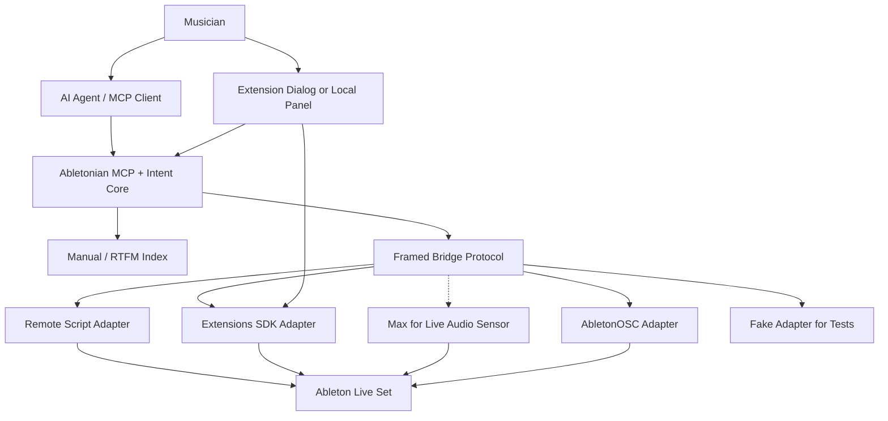

# Ableton Integration Options

Abletonian should use the deepest reliable interface available for each job,
not force every workflow through one integration surface. Ableton Live exposes
several useful surfaces, each with different tradeoffs.

## Summary Matrix

| Surface | Depth | Best Use | Main Risk |
| --- | --- | --- | --- |
| Python Remote Script / Control Surface | Very deep | Structural automation, project state, tracks, clips, devices, transport, browser loading | Custom Python API is powerful but not documented as a stable public API |
| Ableton Extensions SDK | Deep, official, versioned | Second Ableton adapter; in-Live UI through dialogs and context menus; one undo step per transaction | Live 12 Suite beta only; runs on a user gesture; no routing, transport, automation, or plug-in loading (as of 2026-11) |
| Max for Live + Live API / LOM | Deep and official | Audio observation (meters, analysis), selected-object context, device-like workflows | Requires Max for Live access and is limited to the Live Object Model |
| AbletonOSC | Medium to deep | Fast bridge baseline, OSC clients, broad existing command surface | Generic OSC surface rather than Abletonian-specific intent/safety model |
| Live 12 Max MIDI Tools | Narrow and native | MIDI generation and transformation inside Clip View | MIDI-note scope only; not suitable for project-wide automation |
| MIDI Mapping / User Remote Scripts | Medium | Hardware control, transport, mixer, performance mappings | Poor fit for structural automation |
| Offline `.als` analysis/manipulation | Potentially deep | Static inspection, linting, recovery, experiments | Unofficial, risky, outside Live's undo/runtime model |
| UI Automation | Shallow to medium | Last-resort gaps only exposed through menus or drag/drop | Brittle, hard to test, sensitive to focus and localization |
| Manual/RTFM Index | Read-only | Grounding, explanations, workflow lookup, citations | Must stay version-aware and avoid acting as a stale copy of the manual |

## Python Remote Scripts / Control Surfaces

Ableton Live supports third-party Remote Scripts, also called Control Surfaces.
Ableton's installation guidance says Live 11 and later use Python 3 for custom
scripts, and scripts placed in the User Library `Remote Scripts` folder appear in
Live's Preferences. See [Installing third-party remote scripts](https://help.ableton.com/hc/en-us/articles/209072009-Installing-third-party-remote-scripts).

This is the same broad class of integration used by projects such as
[AbletonOSC](https://github.com/ideoforms/AbletonOSC) and
[ableton-mcp](https://github.com/ahujasid/ableton-mcp).

### What It Can Do Well

- Run code inside Live's process.
- Access the current song, tracks, clips, devices, mixer devices, scenes, and
  transport.
- Schedule mutations onto Live's main thread.
- Create and duplicate tracks where APIs expose those actions.
- Rename and recolor tracks, clips, chains, and scenes.
- Inspect selected track/device/clip context.
- Expose a local bridge to external processes through TCP, OSC, or another
  framed protocol.

### Why Abletonian Should Use It

The Remote Script path is the most plausible way to build high-authority
workflow automation such as Drum Rack extraction, batch track creation, routing,
renaming, recoloring, and undo-aware mutations.

### Engineering Constraints

- Treat the Python surface as version-sensitive.
- Keep the in-Live script small and robust; push orchestration, planning, and AI
  behavior out to the Abletonian core.
- Never expose raw Python object access directly to MCP clients.
- Use a framed bridge protocol with request IDs, timeouts, and typed errors.
- Build a fake adapter with the same protocol for CI and workflow tests.

## Ableton Extensions SDK

Ableton announced the Extensions SDK on 2026-06-02 as an experimental public
beta for Live 12 Suite (12.4.5 beta or later). Extensions are TypeScript or
JavaScript packages that run in an Extension Host process Live owns, are
installed as `.ablx` archives, and register commands and context-menu actions
that the user invokes. Everything in this section comes from the
[landscape review](../research/2026-11-landscape-and-direction-review.md),
section 2, which could reach Ableton's own pages only through search snippets
and relied on a community mirror of the SDK reference. Treat it as
**unverified** until someone reads the official docs or runs an extension.

### What It Can Do Well

- Officially sanctioned and versioned (API 1.0.0 in the community mirror).
- `context.withinTransaction(fn)` makes a set of edits one undo step, which is
  abletonian's "one undo step, fail closed" rule as a primitive.
- Tracks, scenes, clips and MIDI notes, devices with parameters, racks and
  chains, Drum Racks, native device insertion by name, track duplication.
- Webview dialogs (`showModalDialog`) and context-menu actions scoped to the
  current selection: a natural home for plan review and the Macro Cockpit.

### What It Cannot Do (as reported)

- Input and output routing, transport and clip launching, automation
  envelopes, loading third-party plug-ins or presets, Live's browser, undo,
  and anything that runs without a user gesture.
- Run on Live Standard, Intro, or Lite.

### How Abletonian Should Use It

As a second Ableton adapter that answers the same bridge protocol and reports
its own capability list, not as a replacement for the Remote Script. The
Remote Script keeps routing, undo, return tracks, selection polling, and
non-Suite users. The adapter interface that makes two Ableton adapters
possible is [RFC 0003](../rfcs/0003-daw-adapter-and-safety-policy.md); the
Extension adapter itself needs its own RFC after a read-only spike.

## Max for Live and the Live Object Model

Ableton documents Max for Live as a way to access and use Live's API, including
the Live Object Model, supported operations, and Max objects/JavaScript tools
used to query, control, and observe Live. See [Controlling Live using Max for Live](https://help.ableton.com/hc/en-us/articles/5402681764242-Controlling-Live-using-Max-for-Live).

Cycling '74's Live API overview describes how objects are addressed through LOM
paths, such as `live_set tracks 2 clip_slots 0 clip`, and identifies the root
objects `live_app`, `live_set`, `control_surfaces`, and `this_device`. It also
documents `live.path`, `live.object`, `live.observer`, `live.remote~`, and the
JavaScript `LiveAPI` object. See [Live API Overview](https://docs.cycling74.com/userguide/m4l/live_api_overview/).

The Live Object Model includes objects directly relevant to Abletonian:

- `Song`
- `Song.View`
- `Track`
- `ClipSlot`
- `Clip`
- `Device`
- `DeviceParameter`
- `RackDevice`
- `DrumPad`
- `Chain`
- `ChainMixerDevice`
- `Scene`
- `CuePoint`

See [LOM - The Live Object Model](https://docs.cycling74.com/legacy/max8/vignettes/live_object_model?q=LOM).

### What It Can Do Well

- Officially documented Live object access.
- Observe selection and state changes.
- Build an in-Ableton device/panel-like companion.
- Access selected track, selected chain, selected parameter, and highlighted clip
  slot through `Song.View`.
- Call functions and set properties exposed by LOM.
- Create MIDI transformations/generators in Live 12 through Max for Live MIDI
  Tools.

### Why Abletonian Should Use It

Max for Live is the one surface that can observe live audio (through
`live.remote~` and analysis devices), which neither Remote Scripts nor the
Extensions SDK can do. That makes it a candidate optional sensor for a future
"did that change make it louder?" check. It is also a good official API
reference for which object classes and operations are reasonable to support.

The in-Live user experience (context strip, quick actions, dry-run review) is
better served by an Extension dialog, which needs no device on a track; see
the Extensions SDK section above.

### Engineering Constraints

- Max for Live devices have limitations around MIDI/audio driver behavior and
  stored parameter state. See [Max for Live Limitations](https://docs.cycling74.com/userguide/m4l/live_limitations/).
- Do not require Max for Live for the core MCP/automation engine if a Remote
  Script can support non-Suite users better.
- Use Max for Live as a companion surface or workflow-specific tool, not the only
  bridge path.

## AbletonOSC

[AbletonOSC](https://github.com/ideoforms/AbletonOSC) is a Remote Script that
exposes an OSC interface to Ableton Live. Its README says the project aims to
expose the entire Live Object Model API and uses Live's object hierarchy and
naming structure. It listens on OSC ports and includes APIs for Song, View,
Track, Clip, Device, and other areas.

### What It Can Do Well

- Provides a tested, existing bridge with broad command coverage.
- Useful for prototyping external clients.
- Good reference for command naming and coverage.
- Includes undo/redo, track creation, duplication, transport, track properties,
  and bulk state queries.

### Why Abletonian Should Not Stop There

AbletonOSC is a control protocol. Abletonian needs a product and safety layer:
dry-run plans, workflow recipes, RTFM grounding, typed capabilities, reviewable
mutations, and musician-facing intent.

AbletonOSC can be an adapter option or reference implementation, not the whole
product architecture.

## Live 12 Max MIDI Tools

Live 12 includes MIDI Tools for transformations and generators in Clip View.
Ableton's manual says Max for Live MIDI Tools can be created or installed as
third-party tools. See [MIDI Tools](https://www.ableton.com/en/live-manual/12/midi-tools/) and
[Using third-party MIDI Tools](https://help.ableton.com/hc/en-us/articles/14462716734876-Using-third-party-MIDI-Tools).

### What It Can Do Well

- Native user workflow for MIDI transformation and generation.
- Scale-aware, Clip View-local actions.
- Good distribution path for note-level operations.

### Limits

This is not a general project automation surface. It is a strong fit for
workflows such as "humanize selected hats" or "generate variation in selected
clip," but not for Drum Rack extraction, session organization, routing, or
project-wide refactoring.

## MIDI Mapping and User Remote Scripts

Ableton supports Control Surfaces and basic user remote scripts for tactile
control of predefined parameters. See [Using Control Surfaces](https://help.ableton.com/hc/en-us/articles/209774285-Using-Control-Surfaces)
and [Creating your own Control Surface script](https://help.ableton.com/hc/en-us/articles/206240184-Creating-your-own-Control-Surface-script).

This is useful for hardware and performance workflows but too limited for
Abletonian's main automation goals.

## Offline `.als` Analysis and Manipulation

Ableton Live Sets are files, and there may be value in offline analysis:

- project linting,
- dependency/sample inspection,
- static documentation,
- diffing saved versions,
- recovery tooling.

However, offline mutation should not be a first-path automation strategy. It
would bypass Live's runtime state, object IDs, undo stack, plugin loading, and
version-specific behavior.

## UI Automation

UI automation can fill gaps where Ableton exposes no API. For example, some
menu-only or drag/drop-only workflows might require keyboard/mouse automation.

Use only as a last resort:

- behind explicit user confirmation,
- with screenshots/logging when possible,
- with focus checks,
- with language/layout assumptions documented,
- with a non-UI fallback or clear unsupported error.

## RTFM / Manual Index

Ableton's manual is versioned and available as web pages and PDFs. The Live 12
manual entry point is [Welcome to Live](https://www.ableton.com/en/live-manual/12/welcome-to-live/).

The manual should become a first-class Abletonian resource:

- fetch relevant manual sections,
- cite exact sources,
- summarize workflows,
- map manual concepts to adapter capabilities,
- answer "can Abletonian automate this today?"

RTFM is not just support content. It is a grounding mechanism that reduces
hallucinated DAW behavior.

## Drum Rack Extraction as Capability Test

Ableton's manual documents Drum Rack chain extraction and says dragging a drum
chain from the mixer to a new track creates a new track containing devices and
MIDI data, while dragging from the chain list extracts only devices. See
[Extracting Chains](https://www.ableton.com/en/live-manual/11/instrument-drum-and-effect-racks/#extracting-chains).

An Abletonian implementation should not begin by simulating drag/drop. Prefer a
deterministic adapter workflow:

1. Inspect selected track and selected Drum Rack.
2. Enumerate pads, chains, notes, devices, names, colors, and clips.
3. Produce a dry-run plan.
4. Duplicate the source track once per selected pad/chain.
5. Remove or mute unrelated chains in each duplicate.
6. Filter duplicated MIDI clips to the relevant note.
7. Rename and color-code each output track.
8. Preserve the original track by default.

This workflow exercises the integration surfaces that matter most: object graph
inspection, mutation safety, clip note editing, naming, color, undo, and
version-aware behavior.

## Recommended Architecture

The core should not care whether a capability is implemented by a Remote Script,
an Extension, AbletonOSC, Max for Live, or a fake adapter. It should care about typed
capabilities, safety policy, and verified results.
